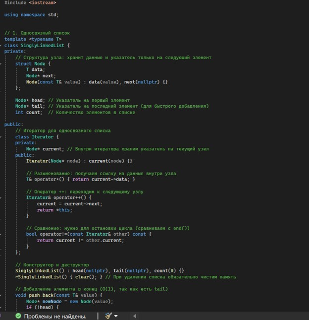
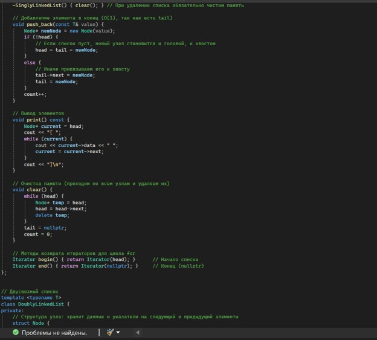
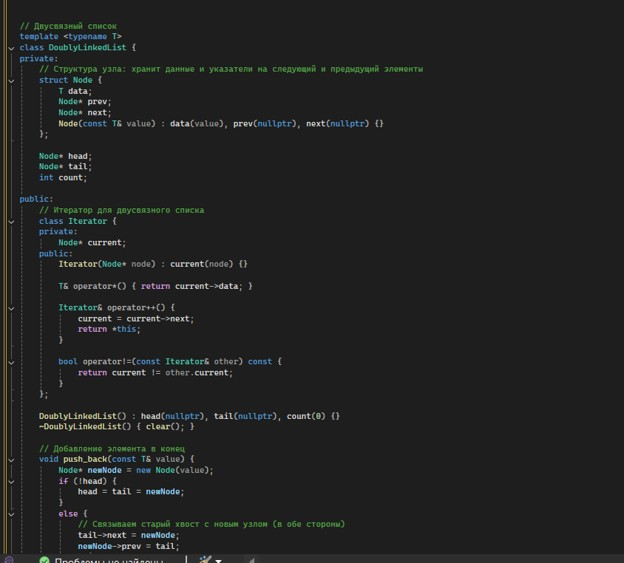
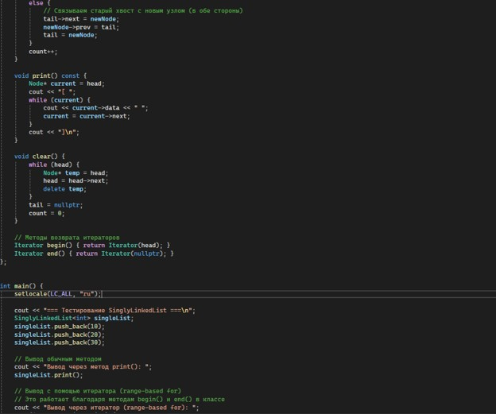
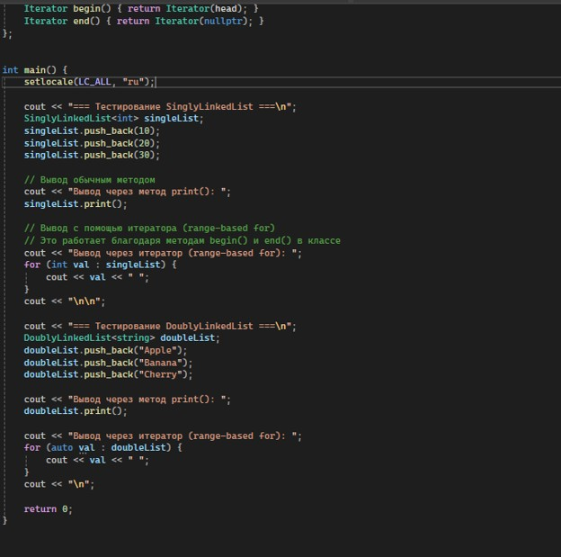

# Лабораторная работа №3
## Односвязный и двусвязный списки

**Выполнила:** *Агафонова Софья Сергеевна*  
**Группа:** *ПИЖ-б-о-25-1*  
**Вариант:** 1 (Продвинутый уровень)

---

## Цель работы

1. Реализовать шаблонный класс односвязного списка 
(SinglyLinkedList) с базовыми операциями
2. Реализовать шаблонный класс двусвязного списка 
(DoublyLinkedList) с базовыми операциями
3. Освоить операции вставки, удаления, поиска и обхода элементов 
в списках
4. Сравнить производительность и особенности использования 
односвязного и двусвязного списков
5. Научиться правильно управлять памятью при работе со списками 
(удаление узлов)

---

## Теоретическая часть

### 1. Понятие связного списка
**Связный список** — это структура данных, в которой элементы (узлы) не хранятся в памяти непрерывно. Каждый узел содержит сами данные и указатель(и) на следующий (и/или предыдущий) узел. 

*   **Односвязный список:** каждый узел хранит данные и указатель на следующий элемент (`next`). Обход возможен только в одном направлении (от начала к концу).
*   **Двусвязный список:** каждый узел хранит данные, указатель на следующий (`next`) и на предыдущий (`prev`) элемент. Позволяет обходить список в обоих направлениях.

### 2. Узлы списков и основные компоненты
*   **Узел (Node)** — базовая единица списка. В коде реализуется через `struct` (или `class`), содержащую поле для данных (`data`) и указатели. 
*   **Head (голова)** — указатель на самый первый элемент списка. С него начинается любой обход. Если список пуст, `head == nullptr`.
*   **Tail (хвост)** — указатель на самый последний элемент списка (у которого `next == nullptr`). Хранение указателя `tail` позволяет оптимизировать добавление элемента в конец списка до `O(1)`.

### 3. Сравнение динамического массива и связных списков
Выбор структуры данных зависит от требуемых операций. Основные различия:

| Операция | Динамический массив (vector) | Односвязный список | Двусвязный список |
| :--- | :--- | :--- | :--- |
| **Доступ по индексу** | `O(1)` | `O(n)` | `O(n)` |
| **Вставка в начало** | `O(n)` | `O(1)` | `O(1)` |
| **Вставка в конец** | `O(1)` амортиз. | `O(1)` с `tail` / `O(n)` | `O(1)` с `tail` |
| **Вставка в середину** | `O(n)` | `O(n)` поиск + `O(1)` | `O(n)` поиск + `O(1)` |
| **Удаление из начала** | `O(n)` | `O(1)` | `O(1)` |
| **Удаление из конца** | `O(1)` | `O(n)` | `O(1)` |
| **Поиск по значению** | `O(n)` | `O(n)` | `O(n)` |
| **Память на элемент** | Только данные | Данные + 1 указатель | Данные + 2 указателя |

**Вывод:** Списки выигрывают при частых вставках и удалениях в начале или середине (если позиция известна), но проигрывают массивам в скорости доступа по индексу и требуют больше памяти на хранение указателей.

## Постановка задачи

**Общее задание:** 
Реализовать оба шаблонных класса — `SinglyLinkedList` (односвязный список) и `DoublyLinkedList` (двусвязный список) — с полной базовой функциональностью (включая корректное управление памятью и деструкторы). Провести сравнение производительности операций для обоих списков.

**Индивидуальное задание:**
Реализовать **итераторы для обоих списков** (методы `begin` и `end`).

### Требования к реализации:
1. **Классы списков:**
   * Реализовать узлы (`Node` и `DNode`) и сами контейнеры с базовыми операциями: `push_front`, `push_back`, `pop_front`, `pop_back`, `find`, `clear`, `size`, `empty`, `print`.
   * Обеспечить строгое управление памятью (освобождение узлов в деструкторе и при удалении элементов).

2. **Реализация итераторов (Вариант 1):**
   * Реализовать вложенные классы итераторов (например, `Iterator` и `ConstIterator`) для обоих списков.
   * Перегрузить необходимые операторы для работы итераторов: разыменование (`*`), доступ к членам (`->`), инкремент (`++`), сравнение (`==`, `!=`).
   * Реализовать методы `begin()` и `end()` (как для константных, так и для неконстантных объектов).
   * Убедиться, что реализованные итераторы позволяют использовать **range-based for** (`for (auto x : list)`).

3. **Сравнение производительности:**
   * Написать демонстрационную программу, которая замеряет время выполнения операций (например, вставка в конец и удаление из начала) для `SinglyLinkedList` и `DoublyLinkedList` на больших объемах данных (например, 10 000 / 100 000 элементов).
---

## Индивидуальное задание

*Рисунок 1- Код программы*

*Рисунок 2- Код программы*

*Рисунок 3- Код программы*

*Рисунок 4- Код программы*
## Результаты работы программы

*Рисунок 5- Результат программы*

## Ответы на контрольные вопросы

**1. Чем связный список отличается от динамического массива?**
Связный список хранит элементы (узлы) в памяти **не непрерывно** (они могут быть разбросаны по куче), связывая их указателями. Динамический массив (например, `std::vector`) хранит элементы в **непрерывной области памяти**. Из-за этого массив обеспечивает быстрый доступ по индексу `O(1)`, но медленную вставку в начало `O(n)`, а список — наоборот.

**2. Какие операции в односвязном списке выполняются за O(1)?**
*   Вставка в начало (`push_front`).
*   Удаление из начала (`pop_front`).
*   Вставка в конец (`push_back`) — **только если** хранится указатель на хвост (`tail`).
*   Вставка после заданного узла (если у нас уже есть указатель на этот узел).

**3. Почему удаление из конца односвязного списка требует O(n) времени?**
Каждый узел односвязного списка хранит указатель только на *следующий* элемент. Чтобы удалить последний узел (`tail`), нужно обнулить указатель `next` у **предпоследнего** узла. Чтобы его найти, необходимо пройти весь список от начала (`head`) до предпоследнего элемента, что занимает `O(n)` времени.

**4. Какие преимущества даёт хранение указателя tail в односвязном списке?**
Указатель `tail` позволяет выполнять вставку нового элемента в конец списка (`push_back`) за время `O(1)`. Без него пришлось бы каждый раз проходить весь список целиком, чтобы найти последний элемент (что заняло бы `O(n)`).

**5. Чем двусвязный список отличается от односвязного?**
В узлах двусвязного списка хранится **два указателя**: на следующий узел (`next`) и на предыдущий (`prev`). Это позволяет обходить список в обоих направлениях (от начала к концу и наоборот), но требует больше памяти под каждый узел.

**6. Какие операции в двусвязном списке выполняются быстрее, чем в односвязном?**
*   **Удаление из конца** (`pop_back`) — выполняется за `O(1)`, так как от `tail` можно сразу перейти к предпоследнему узлу по указателю `prev`.
*   **Удаление или вставка перед заданным узлом** — выполняется за `O(1)`, если есть указатель на этот узел (не нужно искать предыдущий).

**7. Что такое «голова» (head) и «хвост» (tail) списка?**
*   **Head (голова)** — это указатель на самый первый узел списка. С него начинается любой обход. Если список пуст, `head == nullptr`.
*   **Tail (хвост)** — это указатель на самый последний узел списка (у которого указатель `next` равен `nullptr`).

**8. Как удалить узел из середины односвязного списка?**
Нужно найти узел, стоящий **перед** удаляемым (пройти `O(n)` шагов от начала). Затем сохранить указатель на удаляемый узел, перекинуть указатель `next` предыдущего узла на узел *после* удаляемого, и освободить память (`delete`) удаляемого узла.

**9. Как удалить узел из середины двусвязного списка? Почему это проще?**
Если у нас есть указатель на удаляемый узел, удаление занимает `O(1)`. Нужно просто связать его соседей напрямую: 
`node->prev->next = node->next;`
`node->next->prev = node->prev;`
Это проще, потому что благодаря указателю `prev` нам **не нужно искать предыдущий узел** с начала списка.

**10. Что произойдёт, если забыть обновить tail при удалении?**
Указатель `tail` будет указывать на уже освобожденную память (появится «висячий» указатель / dangling pointer). Если после этого вызвать `push_back`, программа попытается записать данные в несуществующий узел, что приведет к неопределенному поведению (ошибке сегментации или повреждению памяти).

**11. Как реализовать реверс односвязного списка?**
Нужно использовать три указателя (`prev = nullptr`, `current = head`, `next = nullptr`). Проходя по списку циклом, на каждом шаге сохраняем `next = current->next`, переворачиваем указатель (`current->next = prev`), сдвигаем `prev = current` и `current = next`. В конце нужно обновить `head = prev`.

**12. Как обнаружить цикл в связном списке?**
С помощью алгоритма Флойда («черепаха и заяц»). Заводятся два указателя: медленный (делает 1 шаг) и быстрый (делает 2 шага). Если в списке есть цикл, быстрый указатель рано или поздно догонит медленный и они встретятся. Если быстрый дойдет до `nullptr`, значит цикла нет.

**13. В каких случаях стоит использовать список вместо массива?**
Когда требуется частая вставка и удаление элементов в начале или середине контейнера (особенно при наличии итераторов/указателей на место вставки). Также списки выгодны, когда заранее неизвестен точный размер данных (нет затрат на реаллокацию) и когда важна стабильность адресов элементов (узлы не перемещаются в памяти при добавлении новых).

**14. Какая дополнительная память требуется для каждого узла списка?**
*   Для **односвязного** списка: память под данные + 1 указатель (`next`).
*   Для **двусвязного** списка: память под данные + 2 указателя (`next` и `prev`).
*(Также может добавляться выравнивающая память (padding) на усмотрение компилятора).*

**15. Почему доступ по индексу в списке имеет сложность O(n)?**
Элементы списка не лежат в памяти друг за другом (непрерывно). Нельзя вычислить адрес нужного элемента по математической формуле (как в массиве). Чтобы добраться до элемента с индексом `i`, нужно всегда начинать с головы (`head`) и переходить по указателям `next` ровно `i` раз.
---

## Выводы

В ходе выполнения лабораторной работы я:
1. Реализовала шаблонный класс односвязного списка 
(SinglyLinkedList) с базовыми операциями
2. Реализовала шаблонный класс двусвязного списка 
(DoublyLinkedList) с базовыми операциями
3. Освоила операции вставки, удаления, поиска и обхода элементов 
в списках
4. Сравнила производительность и особенности использования 
односвязного и двусвязного списков
5. Научилась правильно управлять памятью при работе со списками 
(удаление узлов)

---

**Ссылка на Git-репозиторий с кодом программы:**  
[https://github.com/agafonovasofa631-collab/-4-.git](https://github.com/agafonovasofa631-collab/-4-.git)
